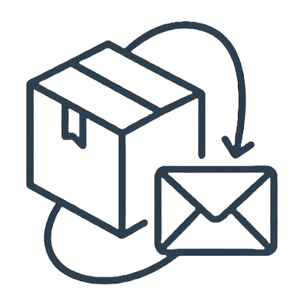

# 📦 Mail Package Tracker for Home Assistant

<p align="center">
  
</p>

<p align="center">
  <a href="https://github.com/hacs/integration"></a>
  <a href="https://github.com/Tabu1973/mail_package_tracker/releases"></a>
  <a href="LICENSE"></a>
</p>

<p align="center">
  <a href="https://my.home-assistant.io/redirect/hacs_repository/?owner=Tabu1973&repository=mail_package_tracker&category=integration" target="_blank">
    
  </a>
  &nbsp;&nbsp;
  <a href="https://my.home-assistant.io/redirect/config_flow_start/?domain=mail_package_tracker" target="_blank">
    
  </a>
</p>

**Mail Package Tracker** is a universal, lightweight Home Assistant custom integration (HACS compatible) that scans your email inbox locally via IMAP for order confirmations, shipping notifications, and delivery updates. It creates a dedicated **Device** for each carrier or online shop, includes a built-in **Sidebar Configuration Panel (`📦 Paket-Tracker`)**, and dynamically creates package sensors for your dashboard.

---

## ✨ Key Features

- **🖥️ Built-in Sidebar Panel (`📦 Paket-Tracker`) with Live Toggle:**
  - Toggle the sidebar entry on or off at any time using the **`Show in Sidebar`** switch (`switch.mail_package_tracker_ubersicht_in_seitenleiste_einblenden`)—no Home Assistant restart required.
  - Manage all **Carriers & Filter Rules**, add new shops, test real emails from your inbox with one click in the **🧪 Live Email Tester**, and manage active packages in a single clean interface.
- **🔄 Full 4-Stage Package Lifecycle:**
  1. 🛒 **`Bestellt` (*Ordered – Awaiting Shipment*)** – Appears as soon as the order confirmation arrives.
  2. 🚚 **`Unterwegs` (*In Transit / Arriving Tomorrow*)** – Automatically upgrades when the shipping confirmation arrives.
  3. ⚡ **`In Zustellung` (*Out for Delivery / Arriving Today*)** – Highlights packages arriving today.
  4. ✅ **`Zugestellt` (*Delivered Today* $\rightarrow$ *Delivered Yesterday* $\rightarrow$ *Delivered on DD.MM.*)** – Automatically cleaned up after `N` days.
- **🔗 Smart Order-ID & Tracking-ID Deduplication (`all_ids`):**
  - Automatically links the order number from an initial order confirmation (e.g., `#SL123456DE` or `303-0000000-1234567`) with the carrier tracking number from a subsequent shipping email (e.g., `00340434000012345678`) so the same shipment never appears twice.
- **📋 Multi-Item Extraction & Simple Plain-Text Rules (No Regex Required!):**
  - Extracts all items in a shipment (e.g., `3 Artikel: 1 PETG + 1 PLA+ ...` plus a full `artikel_liste` array attribute).
  - Configure rules using simple plain-text keywords or prefixes (e.g., `DHL Trackingnummer:, Bestellung` or `*` for bullet lists)—regular expressions are optional for advanced users.
- **🚚 Built-in Carrier & Shop Presets:**
  - Ready out of the box with presets for **Amazon, DHL, DPD, Hermes, GLS, UPS, AliExpress, and Sunlu**.
- **📬 Lightweight & Privacy-Friendly IMAP Polling:**
  - Detects **both read and unread** emails from the last `N` days (default: **3 days**, configurable `1–14` days) using IMAP `SINCE`.
  - Uses `readonly=True` and `BODY.PEEK[]<0.300000>`: **Unread emails remain unread** in your inbox, and large attachments (PDFs, images, ZIPs) are **never downloaded or stored** in Home Assistant.

---

## 🚀 Installation

### Option 1: Via HACS (Recommended)

[](https://my.home-assistant.io/redirect/hacs_repository/?owner=Tabu1973&repository=mail_package_tracker&category=integration)

1. Click the **Open HACS Repository** button above (or open **HACS** $\rightarrow$ **Three-dots menu** $\rightarrow$ **Custom repositories** and add `https://github.com/Tabu1973/mail_package_tracker` as category **Integration**).
2. Click **Download** on **Mail Package Tracker**.
3. Restart Home Assistant.

### Option 2: Manual Installation
1. Copy the `custom_components/mail_package_tracker` folder into your Home Assistant `/config/custom_components/mail_package_tracker` directory.
2. Restart Home Assistant.

---

## ⚙️ Configuration

[](https://my.home-assistant.io/redirect/config_flow_start/?domain=mail_package_tracker)

1. Click the **Add Integration** button above (or navigate to **Settings $\rightarrow$ Devices & Services $\rightarrow$ Add Integration $\rightarrow$ Mail Package Tracker**).
2. Enter your IMAP credentials (for **Gmail**: `imap.gmail.com`, port `993`, and a 16-character Google **App Password**).
3. Open **📦 Paket-Tracker** in the Home Assistant sidebar to customize carrier rules, add new shops, or test emails live.

---

## 🛠️ Services

| Service | Description |
| :--- | :--- |
| `mail_package_tracker.scan_now` | Immediately triggers an IMAP inbox scan and evaluates all enabled rules. |
| `mail_package_tracker.remove_package` | Removes a specific package by its `unique_id` (e.g., `paket_sunlu_sl123456de`). |
| `mail_package_tracker.clear_delivered` | Immediately removes all packages currently marked as `Zugestellt` (*Delivered*). |
| `mail_package_tracker.process_email` | Manually feeds an email (`sender`, `subject`, `text`, `html`) into the parser. |

---

## 📊 Package Sensor Attributes (`sensor.paket_<carrier>_<id>`)

| Attribute | Example | Description |
| :--- | :--- | :--- |
| `unique_id` | `paket_sunlu_sl123456de` | Unique package identifier |
| `zusteller` | `Sunlu` / `Amazon` / `DHL` | Display name of the shop or carrier |
| `inhalt` | `3 Artikel: 1 PETG + 1 PLA+...` | Extracted package contents / summary |
| `artikel_liste` | `["1 PETG", "1 PLA+"]` | Full list of individual items in the shipment |
| `status` | `Bestellt` / `Unterwegs` / `In Zustellung` / `Zugestellt` | Current lifecycle stage |
| `zustellung` | `Warte auf Versand` / `In Kürze erwartet` / `Ankunft morgen` / `Ankunft heute` / `Heute zugestellt` | Delivery timing (also the sensor's main state) |
| `tracking_id` | `00340434000012345678` | Primary tracking or order number |
| `all_ids` | `["00340434000012345678", "SL123456DE"]` | All linked order & tracking IDs for deduplication |
| `tracking_url` | `https://www.dhl.de/...` | Direct tracking link |
| `aktualisiert_am` | `21.10.2026 15:00` | Timestamp of the last update |
| `zugestellt_am` | `2026-10-21` | ISO delivery date (used for automatic cleanup) |

---

## 🎨 Example Dashboard Card (Mushroom + `auto-entities`)

If you use [Mushroom Cards](https://github.com/piitaya/lovelace-mushroom) and [auto-entities](https://github.com/thomasloven/lovelace-auto-entities) from HACS, you can add a fully automatic package dashboard card using this YAML:

```yaml
type: custom:auto-entities
card:
  type: grid
  columns: 1
  square: false
card_param: cards
filter:
  template: |
    
    
    
    
    
    {% set today_str = now().date().strftime('%Y-%m-%d') %}
    
    

    
      
      
        
      
    

    
      
      
        
      
    

    
      
      
        
      
    

    {{ ns.cards | to_json }}
```

---

## 🤝 Contributing & Adding More Carriers / Shops

Because every online shop and parcel carrier formats its notification emails slightly differently, community contributions are very welcome!
- Created a working filter rule for another shop or carrier (e.g., *Otto, Zalando, eBay, Mindfactory, Bambu Lab, Prusa, FedEx, USPS, Royal Mail, Post AT / CH*)?
- Open an **Issue** or submit a **Pull Request** with your filter keywords (or an anonymized sample email) so we can include it in the default presets in [`const.py`](custom_components/mail_package_tracker/const.py)!

---

## 📄 License

MIT License – free to use and adapt for the Home Assistant community.
